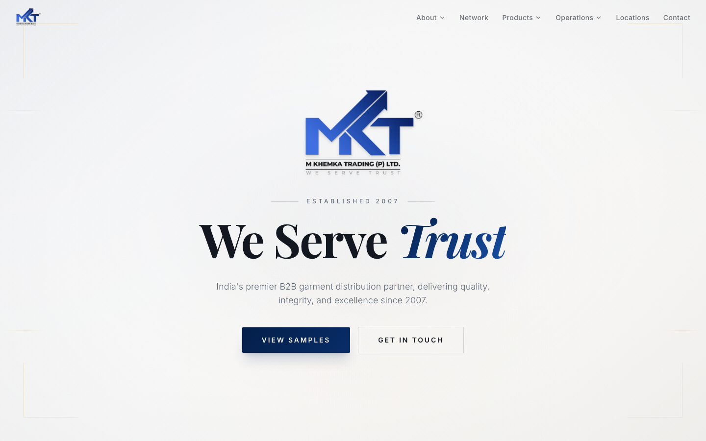
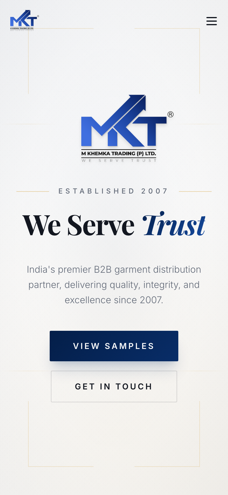

# M Khemka Trading: Company Website

Business website for M Khemka Trading Pvt. Ltd., a readymade-garments trading company in Kolkata.

**Live site:** [https://mktpvt.ltd](https://mktpvt.ltd)



## Why I built it

The business had no online presence. I designed and launched this site as part of a wider digitisation project for the family business, alongside an AI invoice-automation pipeline and an internal task-management app (TaskFlow). Built Jun–Jul 2026.

## Features

- **Homepage** with a full-screen hero, a scrolling brand-name marquee, a brand logo grid, an about section with key stats, company pillars, office locations and a "why work with us" section for retailers, brands and partners.
- **Inner pages:** Company Overview, Our Journey (timeline from 2007 to the present), Mission & Vision, Operations (supply chain, logistics, distribution), Brand Partners and Products.
- **Brand network:** a grid of 100+ partner brand logos, loaded automatically from `src/assets/brands/` using Vite's `import.meta.glob`, so adding a brand is just adding an image.
- **Product catalogue:** Men's, Women's and Kids wear, Summer and Winter collections, and festive collections (Eid, Durga Puja, Diwali, Chhath Puja). Includes an image lightbox with keyboard navigation.
- **Navigation:** multi-level dropdown menus on desktop, a collapsible menu on mobile, and deep links into page sections (for example `/products#kids-wear`, `/operations#logistics`).
- **Locations:** cards for the head office and branch, with Google Maps directions links.
- **Contact form:** client-side validation and toast feedback. Messages are sent through a Supabase Edge Function that emails the enquiry via Resend.
- **Responsive design** for mobile, tablet and desktop, with scroll-triggered animations (Framer Motion).
- **SEO basics:** page title, meta description and Open Graph tags.



## Tech stack

- **React 18** + **TypeScript**, built with **Vite**
- **React Router** for client-side routing
- **Tailwind CSS** + **shadcn/ui** (Radix UI primitives)
- **Framer Motion** for animations
- **Supabase Edge Functions** (Deno) + **Resend** for the contact form email
- Hosted as a static build (`.htaccess` SPA rewrite included; a `vercel.json` is also provided)
- Initially built with **[Lovable](https://lovable.dev)**, then customised and extended

## Run locally

```bash
npm install
npm run dev
```

Other scripts: `npm run build` (production build into `dist/`), `npm run preview`, `npm run lint`, `npm run test`.

The site itself runs without any environment variables. To deploy the contact-form backend, copy `.env.example` to `.env` and set `RESEND_API_KEY` as a secret on the Supabase Edge Function.

## Project structure

```
src/
  pages/        Route-level pages
  components/   Page sections (Navbar, Hero, Brands, Contact, ...) and shadcn/ui primitives
  data/         Brand list (auto-generated from the logo folder)
  assets/       Brand logos and product/operations images
supabase/
  functions/send-contact-email/   Edge Function for the contact form
public/         Logo, favicon, robots.txt, .htaccess
```

## Author

**Arpit Khemka**: [linkedin.com/in/arpit-khemka](https://www.linkedin.com/in/arpit-khemka)
